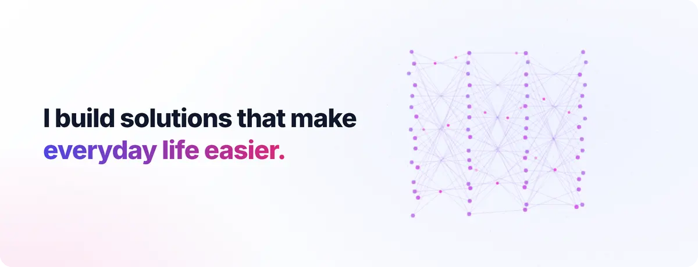

  

 

<picture>
  <source media="(prefers-color-scheme: dark)" srcset="./head8-dark.svg" />
  
</picture>

<picture>
  <source media="(prefers-color-scheme: dark)" srcset="./cat4-cv-dark.svg" />
  
</picture>

<a href="https://study-spot-asu.vercel.app"></a>
<a href="https://proctor-zoom-site.vercel.app">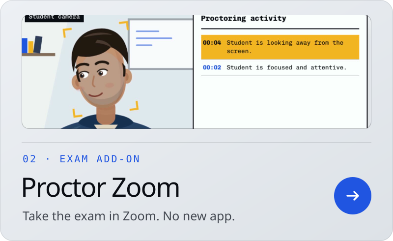</a>

<picture>
  <source media="(prefers-color-scheme: dark)" srcset="./cat4-hw-dark.svg" />
  
</picture>

<a href="https://mindcontrol-site.vercel.app">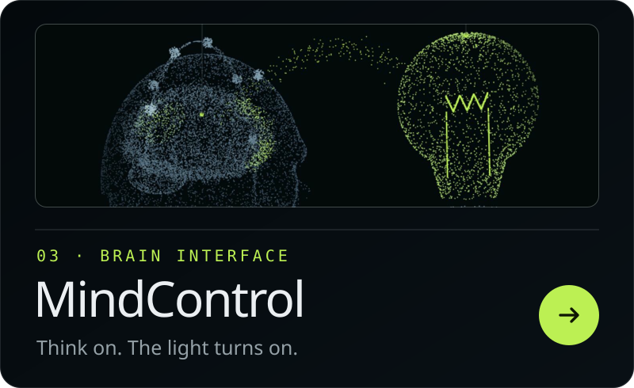</a>
<a href="https://proton-site-alpha.vercel.app">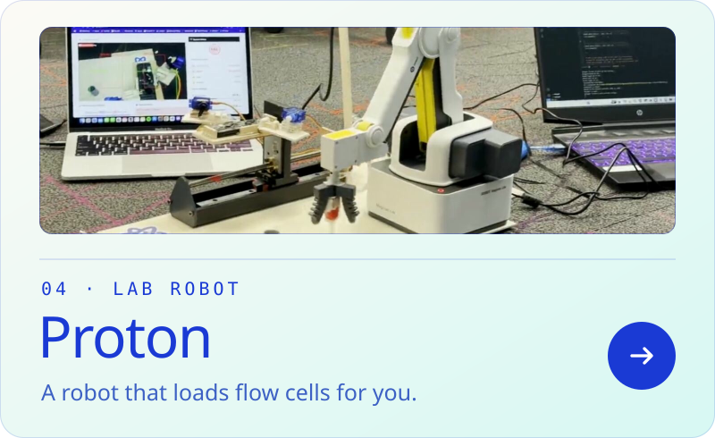</a>
<a href="https://honeywell-site.vercel.app">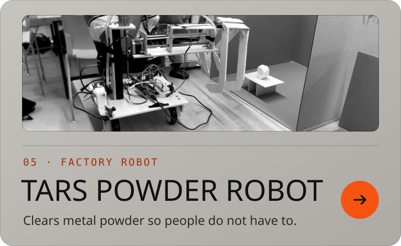</a>

<picture>
  <source media="(prefers-color-scheme: dark)" srcset="./cat4-ai-dark.svg" />
  
</picture>

<a href="https://fema-dassh-site.vercel.app">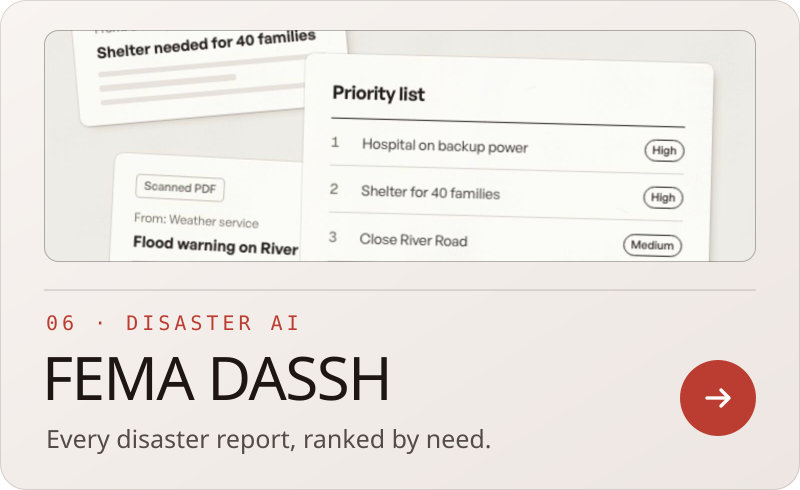</a>

<picture>
  <source media="(prefers-color-scheme: dark)" srcset="./cat4-web-dark.svg" />
  
</picture>

<a href="https://rubric-mate.vercel.app"></a>

<a href="https://first-generation-connect.vercel.app"></a>
<a href="https://newsrecall.vercel.app"></a>
<a href="https://slidesift.vercel.app"></a>

<picture>
  <source media="(prefers-color-scheme: dark)" srcset="./cat4-games-dark.svg" />
  
</picture>

<a href="https://stickmath.com"></a>
