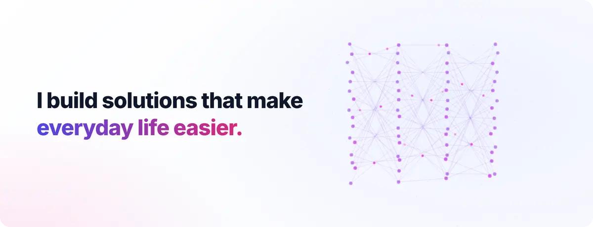
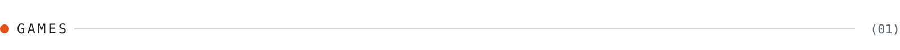

  

 

<picture>
  <source media="(prefers-color-scheme: dark)" srcset="./h-projects-dark.svg" />
  
</picture>

<picture>
  <source media="(prefers-color-scheme: dark)" srcset="./c-games-dark.svg" />
  
</picture>

<picture>
  <source media="(prefers-color-scheme: dark)" srcset="./c-web-dark.svg" />
  
</picture>

