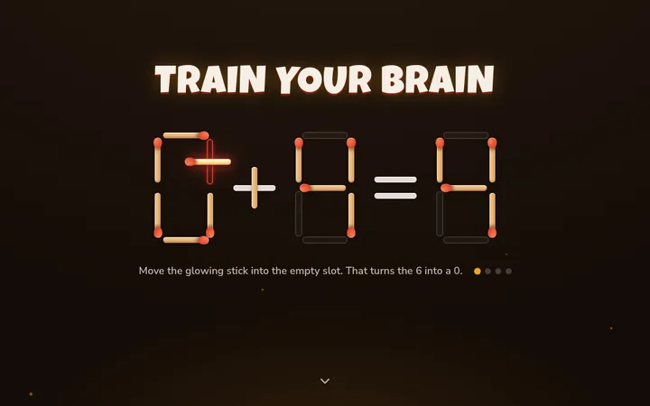
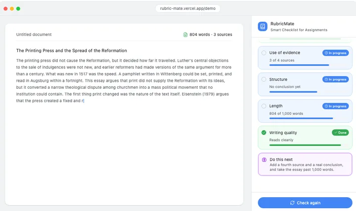

  

<h2 align="center">Projects</h2>

<table>
<tr>
<td width="33%" valign="top">

 <b><a href="https://stickmath.com">Stick Math</a></b>
 A matchstick puzzle game with over 1,000 puzzles and a 60 second rush mode.
</td>
<td width="33%"></td>
<td width="33%"></td>
</tr>
</table>

<table>
<tr>
<td width="33%" valign="top">

 <b><a href="https://rubric-mate.vercel.app">RubricMate</a></b>
 Turn an assignment rubric into a live checklist while you write.
</td>
<td width="33%"></td>
<td width="33%"></td>
</tr>
</table>
