  

 

<picture>
  <source media="(prefers-color-scheme: dark)" srcset="./head8-dark.svg" />
  
</picture>

<picture>
  <source media="(prefers-color-scheme: dark)" srcset="./cat2-web-dark.svg" />
  
</picture>

<picture>
  <source media="(prefers-color-scheme: dark)" srcset="./cat2-cv-dark.svg" />
  
</picture>

<picture>
  <source media="(prefers-color-scheme: dark)" srcset="./cat2-games-dark.svg" />
  
</picture>

